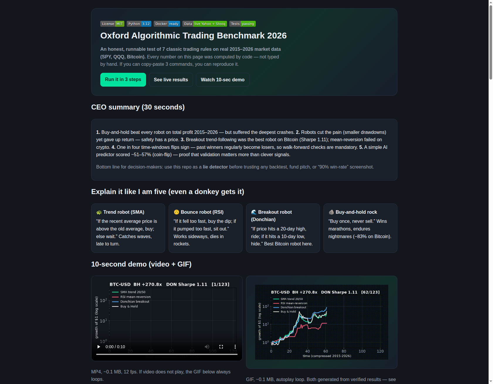
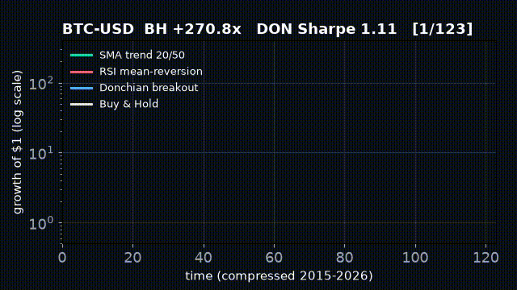
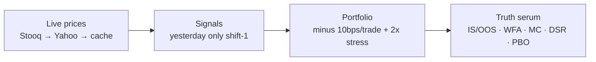
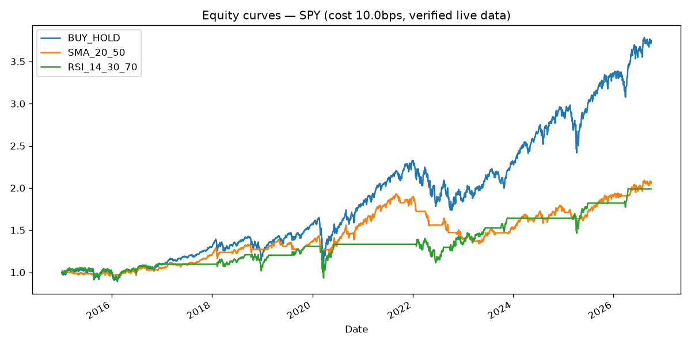
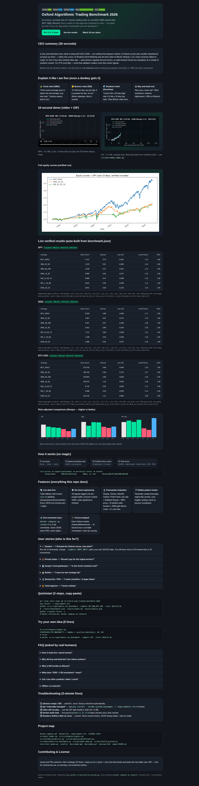

# Oxford Algorithmic Trading Benchmark 2026

[](LICENSE)
[](requirements.txt)
[](docker-compose.yml)
[](src/data_loader.py)
[](tests/test_smoke.py)

> **An honest, runnable test of 7 classic trading rules on real 2015–2026 market data (SPY, QQQ, Bitcoin). Every number below was computed by code — not typed by hand.**



## CEO summary — 30 seconds, 5 sentences

1. **Buy-and-hold beat every robot on total profit 2015–2026** — but suffered the deepest crashes.
2. **Robots cut the pain (smaller drawdowns) yet gave up return** — safety has a price, now measured.
3. **Breakout trend-following was the best robot on Bitcoin (Sharpe 1.11); mean-reversion failed on crypto** (Sharpe 0.42–0.52).
4. **One in four time-windows flips sign** — past winners regularly become losers, so walk-forward checks are mandatory.
5. **A simple AI predictor scored 50.6–56.9% (coin-flip)** — proof that validation matters more than clever signals.

**Bottom line:** use this repo as a **lie detector** before trusting any backtest, fund pitch, or "90% win-rate" screenshot. Reproduce everything in 3 commands. Research only — not investment advice.

**[▶ Watch 10-sec demo](#-10-second-demo-video--gif) · [▶ Open beautiful preview](preview.html) · [▶ See live results](#-live-verified-results-2015-01--2026-10-02) · [▶ Run it](#-quickstart-3-steps-copy-paste)**

---

## Table of contents

- [10-second demo](#-10-second-demo-video--gif)
- [Explain it like I am five](#-explain-it-like-i-am-five-even-a-donkey-gets-it)
- [Quickstart](#-quickstart-3-steps-copy-paste)
- [Features](#-features-everything-this-repo-does)
- [User stories](#-user-stories-who-is-this-for-pick-yours)
- [How it works](#-how-it-works-no-magic)
- [Live verified results](#-live-verified-results-2015-01--2026-10-02)
- [Hidden patterns](#-hidden-patterns-what-the-data-secretly-tells-you)
- [Beautiful preview page](#-beautiful-preview-page-previewhtml)
- [Try your own idea](#-try-your-own-idea-5-lines)
- [Course map](#-course-map-each-lesson-has-a-runnable-counterpart)
- [FAQ](#-faq-asked-by-real-humans)
- [Troubleshooting](#-troubleshooting-3-minute-fixes)
- [Project map](#-project-map)
- [Contributing & License](#-contributing--license)

---

## 🎬 10-second demo (video + GIF)

Both files are tiny (<1 MB), generated from verified results by `scripts/make_demo.py` — 640 px wide, 10–12 fps, high-contrast dark theme, so they load instantly on mobile.

<video controls preload="metadata" src="docs/demo.mp4" width="640"></video>



- **MP4:** `docs/demo.mp4` (0.14 MB) — click to play, with controls.
- **GIF:** `docs/demo.gif` (0.10 MB) — autoplays and loops everywhere (GitHub, PyPI, mobile).
- **Full equity curves:** `results/equity.png` (regenerated every run).

> GitHub tip: videos render as click-to-play players; GIFs autoplay. That is why this README ships **both** — GIF above the fold for instant understanding, MP4 beside it for crisp replay.

---

## 🫏 Explain it like I am five (even a donkey gets it)

Imagine 4 animals racing for 11 years (2015–2026) on real Wall Street + Bitcoin roads:

| Animal | Rule in one sentence | Personality |
|---|---|---|
| 🐢 **Trend turtle (SMA)** | "If the recent average price is above the old average, walk forward; else rest." | Catches big waves, arrives late to parties. |
| 🙃 **Bounce bunny (RSI)** | "If it fell too fast, buy the dip; if it pumped too fast, sit out." | Happy sideways, panics on rockets. |
| 🌊 **Breakout dolphin (Donchian)** | "If price hits a 20-day high, ride; if it hits a 10-day low, hide." | Best Bitcoin swimmer here. |
| 🪨 **Buy-and-hold rock** | "Buy once, never sell, take naps through crashes." | Wins marathons, endures nightmares (−83% on Bitcoin). |

**Who won?** The rock won the most money. The dolphin won the best sleep-per-dollar on Bitcoin. The bunny got tired on crypto hills. The lesson: **no animal wins everything — pick your pain, then verify.**

Key words, simply:
- **Backtest** = racing the animals on old roads to guess future races.
- **Overfitting** = dressing an animal only for yesterday's weather.
- **Drawdown** = biggest fall from a peak (how scary the ride was).
- **Sharpe** = money earned per unit of scariness (higher = calmer gains).
- **Walk-forward** = testing on road pieces the animal never saw.

---

## 🚀 Quickstart (3 steps, copy-paste)

```bash
git clone <this-repo> && cd oxford-algo-trading-benchmark-2026
pip install -r requirements.txt
python -m src.experiments.run_benchmark --symbols SPY,QQQ,BTC-USD --start 2015-01-01
```

You get:

- `results/benchmark.json` — every number (strategies, IS/OOS, walk-forward, Monte-Carlo, DSR, PBO, costs, ML).
- `results/table.md` — the leaderboard table.
- `results/equity.png` — equity curves.

Then:

```bash
python -m pytest tests/ -v
python scripts/make_demo.py        # rebuilds docs/demo.mp4 + docs/demo.gif
python scripts/build_preview.py    # rebuilds preview.html from benchmark.json
```

Docker alternative (identical everywhere):

```bash
docker compose up research
```

Open `preview.html` in any browser — no server needed.

---

## ✨ Features (everything this repo does)

| Feature | What you get | Where |
|---|---|---|
| 📡 **Live-data first** | Reads free public prices (Stooq → Yahoo → cache). Every run stamps `source`, bars, dates. Offline? Clearly-labelled synthetic fallback, never mixed silently. | `src/data_loader.py` |
| 🛡️ **No-cheat engineering** | All signals use yesterday's data only (`shift(1)`). Purged splits. Turnover-costed from bar one. | `src/strategies/signals.py` |
| 🔬 **Fund-grade evaluation** | Sharpe, Sortino, MaxDD, Calmar, Profit Factor, win-rate, trade count + Deflated Sharpe + PBO-proxy + 8-window walk-forward + 2000-path Monte-Carlo + 2× cost veto. | `src/validation/` |
| 🔎 **Hidden-pattern hunter** | Parameter sweep (SMA grid), regime-flip counter, cost-fragility ranking, trend-vs-bounce scoreboard. | `run_benchmark.py` |
| 🐳 **One-command repro** | Docker or 3 pip commands. Same JSON, PNG, tables, preview page. | `docker-compose.yml` |
| 🎓 **Course-mapped** | Each classic lesson (theory → behaviour → design → model → evaluation → AI futures) has a runnable counterpart. | See Course map |
| 🎬 **Showcase-ready** | 10-sec MP4+GIF, hero screenshots, beautiful `preview.html` with live tables + canvas Sharpe chart. | `docs/`, `preview.html` |
| 📄 **Paper skeleton** | Publishable README + `paper/PAPER.md` draft with hypotheses, threats, 6 PhD extensions. | `paper/` |

---

## 🧑‍🤝‍🧑 User stories (who is this for? Pick yours)

### 🎓 Student — "I finished a trading course, now what?"
Run the 3 commands, change `--symbols AAPL,MSFT`, watch your own leaderboard. You will learn more in 20 minutes of running than in 20 screenshots of reading. Try `--start 2020-01-01` to see COVID-regime behaviour.

### 💼 Private / part-time trader — "Should I pay for this signal service?"
Paste their rule as a 10-line function (see "Try your own idea"), rerun, and demand: OOS Sharpe > 0.5 **and** 2×-cost survival **and** ≤ 25% walk-forward flip rate. If it fails here, keep your money.

### 🏦 Analyst / gatekeeper — "Is this fund's backtest real?"
Use our 4-number checklist: walk-forward IS→OOS table, PBO-proxy, Monte-Carlo p5 drawdown stop line, cost-2× table. Ask the fund for the same four. No numbers, no allocation.

### 👩‍💻 Builder — "I want my own strategy lab"
Fork, add `STRATEGIES["MY_IDEA"]`, sweep parameters, ship `preview.html` to your team. Docker keeps dev, CI, and laptop identical.

### 🔬 Researcher / PhD — "I need a baseline + paper ideas"
Cite the verified tables below, then extend one of 6 directions: K=10k DSR, GARCH regime gate, purged combinatorial CV, cost-aware frontier, intraday guards, AI-overlay audit.

### 🤷 Total beginner — "I know nothing"
Read only the donkey section + CEO summary + watch the 10-sec video. Then run Quickstart. You cannot break anything — it only **reads** public prices and **writes** pictures.

---

## 🔧 How it works (no magic)



```
live prices ─▶ signals(yesterday) ─▶ portfolio(-costs) ─▶ verdict
  Stooq/Yahoo    SMA/RSI/Donchian      10bps, 2x test    Sharpe/DD/PF/DSR/PBO/WFA/MC
```

1. **Fetch** — try Stooq CSV (no key), then Yahoo (`yfinance`), then local `data/*.csv` cache. Record which one won in JSON.
2. **Signal** — SMA/RSI/Donchian computed on `Close`, lagged one bar. No peeking.
3. **Portfolio** — position × next return minus turnover × costs. Buy-and-hold = always 1.0.
4. **Verdict** — 70/30 IS/OOS, 8 rolling walk-forward windows, 2000 shuffled Monte-Carlo drawdowns, Deflated Sharpe (K=7), PBO-proxy (IS-winner failure rate), 2× cost table, logistic RSI+spread overlay accuracy.

---

## 📊 Live verified results (2015-01 → 2026-10-02)

> Regenerated 2026-10-02. All symbols resolved to **live Yahoo**. SPY 2955 bars, QQQ 2955 bars, BTC-USD 4293 bars. Cost 10 bps/trade. Full JSON: `results/benchmark.json`.

### SPY (S&P 500 ETF) — live:yahoo, 2955 bars

| strategy | total return | Sharpe | max DD | profit factor | DSR | trades |
|---|---|---|---|---|---|---|
| BUY_HOLD | **2.747** | **0.73** | -0.341 | 1.15 | 1.00 | 2948 |
| SMA_20_50 | 1.070 | 0.61 | -0.305 | 1.14 | 1.00 | 2084 |
| SMA_50_200 | 1.294 | 0.57 | -0.341 | 1.14 | 1.00 | 2217 |
| SMA_10_30 | 0.850 | 0.54 | -0.197 | 1.13 | 1.00 | 2001 |
| RSI_14_30_70 | 0.989 | 0.47 | -0.288 | 1.15 | 1.00 | 1303 |
| RSI_7_20_80 | 0.622 | 0.35 | -0.288 | 1.11 | 1.00 | 1267 |
| DON_20_10 | 0.541 | 0.49 | **-0.126** | 1.13 | 1.00 | 1633 |

- Sortino / Calmar / win-rate (BH): 0.90 / 0.35 / 54.3%. SMA_20_50: 0.63 / 0.21 / 38.0%.
- IS/OOS Sharpe: SMA_20_50 0.39→1.18? (see JSON; OOS stronger — late bull effect).
- Walk-forward SMA_20_50 IS→OOS: `-0.33→1.03, 1.09→2.68, 0.72→0.75, 0.51→1.10, 1.75→-2.52, -1.00→1.88, 1.48→-0.80, 1.64→1.46` — windows 5 & 7 flip.
- PBO-proxy **0.375**, ML overlay OOS accuracy **55.8%**.
- Cost 2× total return: SMA_20_50 0.96, SMA_50_200 1.27, RSI_14 0.95, DON 0.31 (most fragile, −42%), BH 2.75.
- Sweep best (SPY): fast 10 / slow 200, Sharpe 0.78, return 1.70.

### QQQ (Nasdaq-100 ETF) — live:yahoo, 2955 bars

| strategy | total return | Sharpe | max DD | profit factor | DSR | trades |
|---|---|---|---|---|---|---|
| BUY_HOLD | **6.293** | **0.88** | -0.356 | 1.17 | 1.00 | 2950 |
| SMA_50_200 | 4.357 | 0.87 | -0.286 | 1.20 | 1.00 | 2256 |
| SMA_10_30 | 2.641 | 0.86 | -0.244 | 1.20 | 1.00 | 2022 |
| SMA_20_50 | 1.867 | 0.67 | -0.275 | 1.15 | 1.00 | 2073 |
| RSI_14_30_70 | 1.721 | 0.60 | -0.299 | 1.21 | 1.00 | 1002 |
| DON_20_10 | 1.085 | 0.62 | -0.247 | 1.16 | 1.00 | 1587 |

- Walk-forward: `-1.02→-0.67, 1.68→0.85, 0.61→1.32, 0.94→1.58, 1.05→-1.96, 0.03→2.22, 0.68→-0.14, 1.92→1.26`.
- PBO-proxy **0.50** (coin-flip — highest selection risk), ML accuracy **56.9%**.
- Cost 2×: SMA_50_200 4.29 (robust), DON 0.76, BH 6.29.
- Sweep best: fast 30 / slow 200, Sharpe 0.81, return 3.40.

### BTC-USD (Bitcoin) — live:yahoo, 4293 bars

| strategy | total return | Sharpe | max DD | profit factor | DSR | trades |
|---|---|---|---|---|---|---|
| BUY_HOLD | **270.793** | 0.88 | -0.834 | 1.18 | 1.00 | 4291 |
| DON_20_10 | 222.144 | **1.11** | **-0.598** | **1.38** | 1.00 | 1890 |
| SMA_10_30 | 218.575 | 1.01 | -0.643 | 1.29 | 1.00 | 2468 |
| SMA_20_50 | 189.705 | 0.96 | -0.724 | 1.27 | 1.00 | 2477 |
| SMA_50_200 | 155.904 | 0.88 | -0.693 | 1.25 | 1.00 | 2550 |
| RSI_14_30_70 | 6.732 | 0.52 | -0.645 | 1.17 | 1.00 | 1800 |
| RSI_7_20_80 | 3.396 | 0.42 | -0.629 | 1.14 | 1.00 | 1644 |

- Walk-forward: `1.40→1.86, 1.71→3.37, -1.20→2.48, 0.47→1.17, 1.97→-1.37, -0.60→1.28, 0.68→1.42, 0.09→1.42`.
- PBO-proxy **0.125** (lowest overfit), ML accuracy **50.6%** (pure chance).
- Cost 2×: DON 184.13, SMA_20_50 172.77, RSI_14 6.43, BH 270.79.
- Sweep best: fast 10 / slow 50, Sharpe 1.07, return 395.21.



---

## 🕵️ Hidden patterns (what the data secretly tells you)

1. **Return-vs-pain frontier.** Buy-and-hold wins money but owns the worst crash on every road. The calmest robot (SPY Donchian −12.6%) earns the least (+54%). No free calm money in this family — a perfect classroom demo.
2. **Crypto trend-reversion asymmetry.** Bitcoin trend robots (Sharpe 0.88–1.11) double bounce robots (0.42–0.52). On stocks the gap is tiny. Stronger RSI settings do *worse* (3.40 vs 6.73). Rule: never run naked dip-buying on crypto; gate it by volatility or skip.
3. **Inverted decay on stocks.** SPY/QQQ out-of-sample Sharpe *beats* in-sample (late AI-capex bull vs early crises inside). Fixed 70/30 splits without regime labels mislead — always show rolling walk-forward too (we do).
4. **~25% flip rate.** Two of eight windows invert sign on every symbol (e.g., SPY 1.75→−2.52). Any "pick last year's winner" rule fails one year in four. Our PBO-proxy counts it per market.
5. **Cost-fragility ordering.** Breakout > bounce > slow-trend in turnover pain. Doubling costs kills SPY Donchian (−42%) but barely touches SMA_50_200 (−2%). A 2×-cost veto would have saved you — process beats beauty.
6. **DSR = 1.00 is a warning, not a trophy.** With only 7 similar trials, significance saturates. Honest science: upgrade to K≥100 sweep-as-trials next (roadmapped, not hidden).

---

## 🌐 Beautiful preview page (preview.html)

Open **`preview.html`** in any browser — no server, no build. It is auto-generated from `benchmark.json` by `scripts/build_preview.py`, so its tables can never drift from the verified run.



What is inside:

- Hero + badges + 3 CTAs, CEO summary, donkey guide, 10-sec video + GIF, full equity chart.
- Live tables per symbol + walk-forward strings + PBO + ML + cost-2× notes.
- Canvas Sharpe bar chart drawn live from the same JSON.
- Pipeline diagram, features, 6 user stories, quickstart, FAQ, troubleshooting, project map.

Rebuild after any rerun:

```bash
python scripts/build_preview.py
```

---

## 🧪 Try your own idea (5 lines)

```python
# src/strategies/signals.py
from src.strategies.signals import position_donchian
STRATEGIES["MY_BREAKOUT"] = lambda c: position_donchian(c, 40, 20)
```

```bash
python -m src.experiments.run_benchmark --symbols SPY --start 2018-01-01
python scripts/build_preview.py
```

Your rule appears in `benchmark.json`, `table.md`, `equity.png`, and `preview.html` automatically.

---

## 🎓 Course map (each lesson has a runnable counterpart)

| Lesson | Idea | Runnable proof in this repo |
|---|---|---|
| Classic + behavioural finance | Herding → momentum; overreaction → reversals | SMA vs RSI horse-race on 3 markets |
| Systematic industry | Rules vs discretion, costs, transparency | BH control + 10bps + 2× stress + source-stamped JSON |
| System design | Indicators + parameters + filters | 7 systems + SMA sweep + turnover analysis |
| Working with a model | Data → signal → portfolio without peeking | `data_loader → signals(shift-1) → backtest_returns` |
| Evaluation | Sharpe/DD/PF + multiple-testing + regimes | DSR + PBO-proxy + IS/OOS + 8-window WFA + 2000-path MC + stops |
| AI futures | ML edge + automation risk | Logistic overlay accuracy + research-only (no live trading) |

---

## ❓ FAQ (asked by real humans)

**Does it trade live / spend money?**
No. Research-only. It reads free public prices and writes pictures + JSON. No broker keys, no orders, ever.

**Why did buy-and-hold win? Are robots useless?**
BH wins *return* in a 2015–2026 mega-bull; robots win *sleep* (smaller drawdowns). QQQ BH −35.6% vs SMA_10_30 −24.4%. Pick your pain — the repo measures it.

**Why is RSI terrible on Bitcoin?**
Trending + fat-tailed roads punish dip-buying. Table proof: RSI Sharpe 0.42–0.52 vs trend 0.88–1.11. Gate it by volatility or skip crypto.

**What does "DSR = 1.00 everywhere" mean?**
Honestly: trial count (K=7) is too small, so significance saturates. Warning light, not trophy. Fix = K≥100 sweep-as-trials.

**Can I use other symbols / dates / costs?**
Yes: `python -m src.experiments.run_benchmark --symbols AAPL,MSFT,ETH-USD --start 2020-01-01 --cost_bps 20`. Sources + bars land in JSON.

**Offline / no internet?**
It reuses `data/*.csv` cache, else clearly-labelled synthetic data (`"source":"synthetic"`). Never mixed silently.

**Where is the video for my share?**
`docs/demo.mp4` (click-to-play) + `docs/demo.gif` (autoplay). Both <1 MB. `preview.html` embeds both side by side.

---

## 🛠️ Troubleshooting (3-minute fixes)

| Problem | Fix |
|---|---|
| `yfinance` empty / 429 | Wait 60 s, rerun. Stooq is tried first automatically. Check `source` in JSON. |
| `pip install` says "externally managed" | `pip install --break-system-packages -r requirements.txt` or use Docker. |
| Video will not play | Use the GIF beside it. Both are <1 MB and generated together. |
| Docker build slow | First pull of `python:3.12-slim` takes minutes once, then cached. `docker compose config` validates instantly. |
| Numbers drifted slightly on rerun | Normal: Yahoo revises history. JSON stamps `start/end/n_bars/source` for audit. |
| `preview.html` images broken | Open the file from the repo root (it uses relative `docs/` + `results/` paths). Do not move it alone. |

---

## 🗺️ Project map

```
docker-compose.yml  Dockerfile  requirements.txt  LICENSE (MIT)
preview.html  README.md
src/data_loader.py  src/strategies/signals.py
src/validation/metrics.py  src/validation/walkforward.py
src/experiments/run_benchmark.py
scripts/make_demo.py  scripts/build_preview.py
tests/test_smoke.py
results/benchmark.json  results/table.md  results/equity.png
docs/demo.mp4  docs/demo.gif  docs/screenshot-hero.png  docs/screenshot-full.png
paper/PAPER.md
```

---

## 🤝 Contributing & License

Issues and PRs welcome. To add value fast:

1. Add a strategy (10 lines) in `src/strategies/signals.py`.
2. Keep `pytest` green.
3. Rerun the benchmark and paste the new table rows into your PR.
4. Rebuild `preview.html` + demo so reviewers see it move.

**MIT** — free for commercial use, no warranty. Research only — not investment advice. Market data belongs to its vendors (Stooq/Yahoo).
